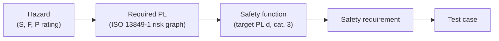

# Cobot cell: hazard analysis and safety concept

[](https://github.com/Madmaxcoder2612/cobot-hara-safety-concept/actions/workflows/ci.yml)


A worked example of the first half of the functional safety lifecycle for a collaborative robot arm that tends a CNC machine while an operator shares its workspace, with no fence.

It goes from **"what can hurt someone?"** to **"what must the control system do about it, and how would we prove it does?"**, and a script checks that the chain from hazard to test has no gaps.

> **Learning project.** The cell is fictional. Nothing here has been validated on real hardware or reviewed by a certified safety engineer. Limit values taken from standards come from public summaries and must be checked against the purchased standard before any real use. See [Limitations](#limitations).

## Contents

- [The chain](#the-chain)
- [Result in numbers](#result-in-numbers)
- [Documents](#documents)
- [Quick start](#quick-start)
- [How it works](#how-it-works)
- [Repository layout](#repository-layout)
- [Standards used](#standards-used)
- [Limitations](#limitations)
- [Next steps](#next-steps)

## The chain

Every safety requirement in a safety case should be traceable back to a hazard and forward to a test. This project keeps that chain in plain CSV files and checks it automatically.



If a safety function has no hazard behind it, a requirement has no test, or a target PL is lower than the PL the hazards demand, the check fails.

## Result in numbers

| | |
|---|---|
| Hazards analysed | 12, across automatic operation, teaching, jam clearing and maintenance |
| Safety functions | 7, each targeted at PL d, category 3 |
| Safety requirements | 20, each with a test case |
| Test cases | 20 (11 test, 5 measurement, 3 inspection, 1 analysis) |
| Hazards handled without a control safety function | 2 (design and information only) |

## Documents

Read them in this order if the topic is new to you.

| # | Document | Question it answers |
|---|---|---|
| 1 | [Method](docs/02-hara-method.md) | What do hazard, risk and Performance Level mean, and how is PLr found? Start here if you are new |
| 2 | [Item definition](docs/01-item-definition.md) | What is the machine, who uses it, which assumptions and open points exist? |
| 3 | [HARA table](docs/04-hara-table.md) | Which hazards exist and what PLr does each one need? |
| 4 | [Safety concept](docs/03-safety-concept.md) | Which safety functions reduce the risk, and what is the safe state? |
| 5 | [Traceability matrix](docs/05-traceability-matrix.md) | How does each hazard connect to requirements and tests? |

The HARA table and traceability matrix are generated from the CSV files in [data/](data/). Edit the data, not the tables.

## Quick start

Requires Python 3.10 or newer. There are no packages to install.

```bash
git clone https://github.com/Madmaxcoder2612/cobot-hara-safety-concept.git
cd cobot-hara-safety-concept
```

Run the consistency check. It regenerates both tables in `docs/`:

```bash
python tools/traceability.py
```

Expected output:

```text
12 hazards, 7 safety functions, 20 requirements, 20 test cases
All traceability checks passed.
```

Run the unit tests, which include every path of the ISO 13849-1 risk graph:

```bash
python -m unittest discover tests
```

Ask the risk graph directly for the required PL of a single hazard (severity, frequency, avoidance):

```bash
python tools/plr.py S2 F1 P2
```

## How it works

| File | Role |
|---|---|
| [data/hazards.csv](data/hazards.csv) | One row per hazard with S, F, P, rationale and measures |
| [data/safety_functions.csv](data/safety_functions.csv) | Trigger, reaction, safe state and target PL of each function |
| [data/requirements.csv](data/requirements.csv) | Requirement text, linked to a safety function |
| [data/test_cases.csv](data/test_cases.csv) | Method, procedure and pass criterion, linked to a requirement |
| [tools/plr.py](tools/plr.py) | The ISO 13849-1 risk graph as code |
| [tools/traceability.py](tools/traceability.py) | Checks the chain and writes the generated tables |

The checks it performs:

- IDs are unique in every file
- S, F and P values are valid
- Every hazard has a safety function or at least one design or information measure
- Every safety function is justified by at least one hazard
- No safety function has a target PL below the highest PLr of the hazards it covers
- Every safety function has a requirement, and every requirement has a test case

GitHub Actions runs the check and the tests on every push, and also fails if the generated tables in `docs/` are out of date.

## Repository layout

```text
.
├── data/                  CSV source of truth
├── docs/                  Method, item definition, safety concept, generated tables
├── tools/                 Risk graph and traceability check
├── tests/                 Unit tests
└── .github/workflows/     CI
```

## Standards used

| Standard | Used for |
|---|---|
| ISO 12100 | Risk assessment method and the three-step risk reduction order |
| ISO 13849-1 | Risk graph, required Performance Level, categories |
| ISO 10218-1 / -2 | Robot and robot cell safety requirements |
| ISO/TS 15066 | Contact force limits for power and force limiting |
| ISO 13850 | Emergency stop |
| IEC 61800-5-2 | Names of the drive safety functions (STO, SS1, SLS, SLP, SBC) |
| IEC 60204-1 | Stop categories and electrical equipment |

The standards themselves are copyrighted and are not included here.

## Limitations

- **Fictional cell, no real measurements.** Test cases describe what would be measured; none has been run.
- **Unverified numbers.** The 140 N force limit, the 250 mm/s speed limit and the PL d / category 3 default are listed as assumptions in the [item definition](docs/01-item-definition.md) and need checking against the standards.
- **ISO 10218:2025 not compared clause by clause.** Listed as an open point.
- **Target, not proof.** The concept sets a PL target. Showing that a real design achieves it needs MTTFd, diagnostic coverage and common cause failure analysis.
- **Not covered:** FMEA and FTA of individual safety functions, speed and separation monitoring, transport, installation and decommissioning.

## Next steps

1. Calculate the achieved PL of one safety function from category, MTTFd, DC and CCF.
2. FMEA and FTA of the Safe Torque Off function.
3. Safety logic for the emergency stop and safely limited speed in IEC 61131-3 Structured Text.

## License

[MIT](LICENSE)
