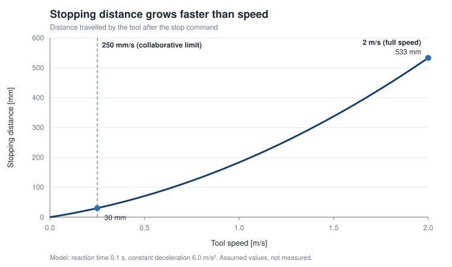

# 6. Stopping distance

A safety function that stops the robot does not stop it instantly. This document shows how far the tool still travels, and why that decides how the speed limit (SF-03) and the position limit (SF-04) have to be set.



## The model

After a stop is triggered, two things happen in sequence:

1. **Reaction time.** The sensor value reaches the safety controller, the controller decides, and the drive starts to brake. The arm keeps moving at full speed meanwhile.
2. **Braking.** The arm decelerates at a constant rate until it stands still.

```text
distance = v × t_react + v² / (2 × decel)
time     = t_react + v / decel
```

| Parameter | Value | Status |
|---|---|---|
| Reaction time `t_react` | 0.10 s | Assumed (A-8) |
| Deceleration `decel` | 6 m/s² | Assumed (A-8) |

The numbers come from [tools/stopping_distance.py](../tools/stopping_distance.py), and the full table is in [figures/stopping-distance-table.md](figures/stopping-distance-table.md).

## What the result says

| Tool speed | Stopping distance | Stopping time |
|---|---|---|
| 250 mm/s (collaborative limit) | 30 mm | 142 ms |
| 2000 mm/s (full speed) | 533 mm | 433 ms |

1. **Distance grows with the square of the speed.** Eight times the speed gives 18 times the distance. The first part, `v × t_react`, grows in proportion to speed, the second part with its square.
2. **That is why the safety planes depend on the speed limit.** SR-12 says the robot must stop *before* a monitored point crosses a safety plane. At 250 mm/s the plane needs a margin of about 30 mm. At full speed it would need more than half a metre. So the arm may only come close to a plane under limited speed.
3. **The stop time requirement is met with some margin.** SR-04 asks for STO within 500 ms. At full speed the model gives 433 ms, but the margin is only about 70 ms. A slower reaction or weaker braking with a heavy payload would break it.
4. **Reaction time matters most at low speed.** At 250 mm/s, 25 mm of the 30 mm is distance travelled during the reaction time. Cutting the reaction time is therefore more effective than braking harder.

## How it connects to the rest of the project

| Where | Link |
|---|---|
| Plane margin and speed limit | SR-09, SR-11, SR-12, tests TC-09, TC-12 |
| Stop time at full speed | SR-04, test TC-04 |
| Assumption behind the numbers | A-8 in the [item definition](01-item-definition.md) |

## Limitations

- **A constant deceleration is a simplification.** A real arm brakes differently depending on pose, payload, joint and temperature, and the stop may be a controlled ramp followed by brake engagement.
- **Both parameters are assumed.** For a real cell, use the manufacturer's published stopping time and distance data for the actual payload and speed, and confirm it by measurement (TC-04, TC-12).
- **Only the tool centre point is modelled.** The elbow and wrist travel different distances, and SF-04 monitors all of them.
- **Direction is ignored.** The model gives the distance along the path. It does not say in which direction the tool leaves its planned path.
